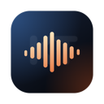
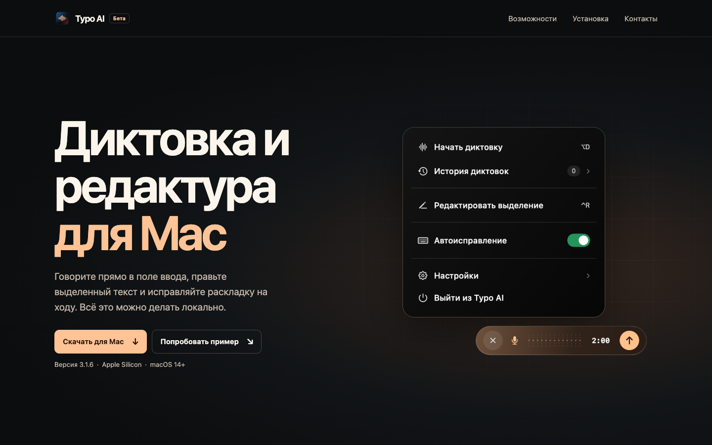
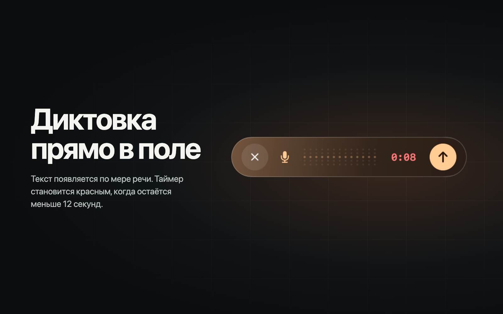
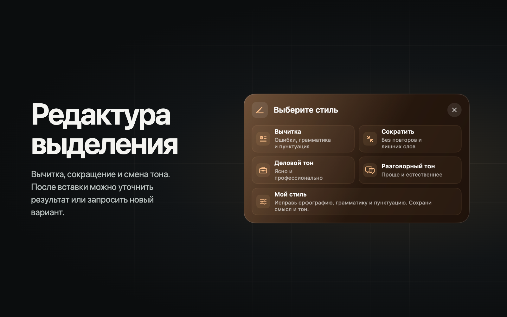
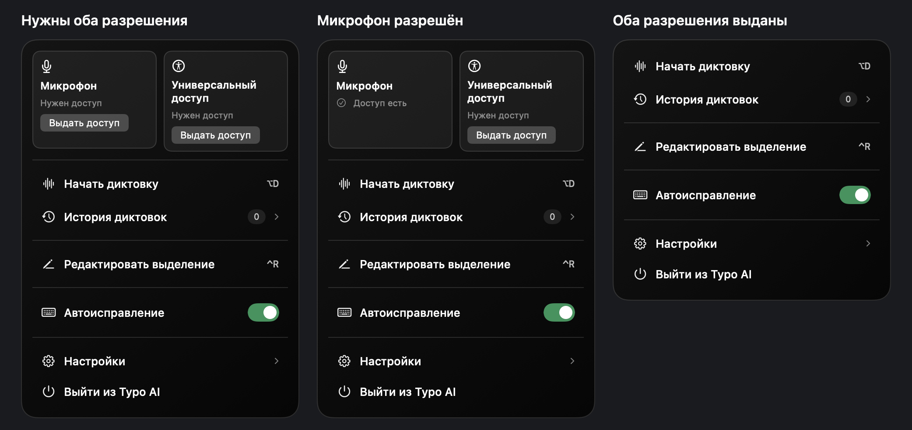

<p align="center">
  
</p>
<h1 align="center">Typo AI</h1>
<p align="center">Диктовка, редактура и смена раскладки в строке меню macOS.</p>
<p align="center">
  <a href="#установка"><strong>Установить для Mac</strong></a>
  · <a href="https://lahuri09.github.io/Typo/">Сайт</a>
  · <a href="#2-через-codex">Установить через Codex</a>
  · <a href="https://github.com/Lahuri09/Typo/releases/tag/v3.1.6">Релиз на GitHub</a>
</p>
<p align="center">Apple Silicon · macOS 14+ · Публичная бета 3.1.6</p>

<p align="center">
  
</p>

Диктуйте прямо в активное поле. Выделите текст, чтобы вычитать, сократить или сменить тон. Если набираете в неверной раскладке, Typo может исправить её по ходу ввода. Диктовка и редактура работают с локальными моделями, в настройках можно выбрать онлайн-провайдера.

## Установка

Для полной сборки нужен Mac с **Apple Silicon** и **macOS 14 или новее**. Архив весит около 1,4 ГБ и включает локальные модели.

### 1. Из ZIP

1. Скачайте ZIP для Apple Silicon из [публичной беты 3.1.6](https://github.com/Lahuri09/Typo/releases/tag/v3.1.6).
2. Распакуйте архив и перенесите **Typo.app** в **Программы**. Откройте приложение.
3. Если Typo ещё нужны разрешения, вверху меню появятся карточки «Микрофон» и «Универсальный доступ». Нажмите **Выдать доступ** и подтвердите запрос macOS. После получения обоих разрешений карточки исчезнут.

Сборка подписана локально. Если macOS остановит первый запуск, откройте **Системные настройки → Конфиденциальность и безопасность → Всё равно открыть**.

### 2. Через Codex

Откройте локальный чат Codex на Mac, куда хотите установить Typo. Скопируйте этот запрос.

```text
Установи Typo AI 3.1.6 на этом Mac.
Репозиторий — https://github.com/Lahuri09/Typo

Проверь, что у меня Apple Silicon и macOS 14 или новее.
Используй локальный ZIP из dist или архив для arm64 из релиза 3.1.6.
Если подходящего архива нет, собери приложение по README из доступной
копии проекта, если её Info.plist указывает версию 3.1.6.

Перенеси Typo.app в «Программы» и проверь, что оно запускается.
Если macOS запросит универсальный доступ или доступ к микрофону,
покажи, где подтвердить запрос.
```

### 3. Из исходников

Для сборки нужен Swift 6.2. Откройте `Package.swift` в Xcode 26 или выполните команды из корня проекта в Terminal с подходящими Command Line Tools.

```bash
./Scripts/test.sh
TYPO_BUNDLE_LOCAL_AI=1 ./Scripts/build-app.sh
open dist/Typo.app
```

Скрипт добавляет локальные модели. После запуска Typo запросит те же разрешения, что и готовая сборка.

## Возможности

| Действие | Что делает Typo |
| --- | --- |
| **Диктовка · ⌃⌥⌘D** | Вставляет распознанные фразы в активное поле. Enter завершает запись. Таймер отсчитывает до двух минут. |
| **Редактура · ⌃R** | Вычитывает или сокращает выделение, меняет тон и применяет свои стили. После вставки можно уточнить правку или запросить новый вариант. |
| **Раскладка · F6 / F7** | Исправляет раскладку на ходу. F6 исправляет слово или выделение вручную, F7 отменяет последнюю правку. |
| **Меню и плавающая панель** | Запускают диктовку и редактуру. Панель можно перемещать и настраивать. Горячие клавиши поддерживают обычные клавиши, комбинации и двойные нажатия. |
| **История диктовок** | Хранит до 30 записей на Mac. Для диктовки без активного поля можно выбрать историю, буфер обмена или требовать поле. |
| **Модели и исключения** | Диктовка и редактура поддерживают свой API. Для раскладки можно добавлять исключения по приложениям и словам. |

## Как выглядит Typo AI

<p align="center">
  
</p>
<p align="center">
  
</p>
<p align="center">
  
</p>

Скриншоты сделаны на демонстрационных данных. [Сайт с интерактивными показами](https://lahuri09.github.io/Typo/).

## Как работает Typo

Раскладка проверяется локально. Полная сборка включает GigaAM v3 для русского языка, многоязычный Whisper Base и Qwen2.5 1.5B. Для английского и автоопределения используется Whisper. Whisper Small можно загрузить из настроек.

При выборе онлайн-провайдера Typo отправляет ему готовую аудиозапись или выделенный текст. Черновик диктовки по мере речи формируется локально. API-ключи хранятся в «Связке ключей» macOS.

<details>
<summary>Раскладка, клавиши и исключения</summary>

Для смены источника ввода после исправления добавьте в настройках macOS **ABC** или **U.S.** и **Русская** или **Русская — ПК**. Преобразование символов соответствует этим раскладкам. Нажимайте `Fn` вместе с функциональной клавишей, если верхний ряд настроен на системные действия.

| Действие | Управление |
| --- | --- |
| Автоисправление | Во время набора в поддерживаемом поле |
| Ручное исправление | F6 для выделения или последнего слова перед курсором |
| Отмена | F7 сразу после исправления |
| Настройка клавиш | Нажмите кнопку назначения и введите обычную клавишу (например, Tab) или комбинацию |
| Двойное нажатие | Включите для нужного действия. Интервал до 350 мс |
| Исключения | Добавьте приложение или слово в настройках Typo |

Автоисправление проверяет оба варианта по системным словарям и локальному частотному словарю из 260 032 словоформ (119 035 EN и 140 997 RU). Узнанный исходный текст сохраняется. Частотный словарь сам по себе разрешает замену для слов из 5–7 букв с минимум 60 употреблениями и слов от 8 букв с минимум 25 употреблениями. Источник и условия распространения данных описаны в `Sources/TypoCore/Lexicons/NOTICE.txt`. Проверка начинается с третьей буквы. Для слов из трёх и четырёх букв действует более строгий частотный порог. Если исходный фрагмент может быть началом распространённого слова, Typo ждёт продолжения. Ручная команда доступна и при выключенном автоисправлении. Типовые терминалы и редакторы кода исключены по идентификаторам приложений. Поля паролей, Secure Event Input и поля без изменяемого AX-выделения пропускаются. В TextEdit и других редакторах с записью выделенного текста Typo заменяет текст через Accessibility. В других редакторах Typo выделяет исходный диапазон через Accessibility, вставляет исправленный текст через ⌘V и восстанавливает содержимое буфера обмена, если за это время его никто не изменил.

Слова-исключения можно добавить вручную. После трёх успешных отмен автоисправления того же слова Typo добавит его автоматически. Для незнакомых слов Typo сравнивает сочетания из трёх букв в обеих раскладках.

</details>

<details>
<summary>Онлайн-провайдеры</summary>

Для редактуры можно выбрать OpenAI, DeepSeek, Claude, Gemini, Kimi, Qwen API или совместимый сервис Chat Completions. Для диктовки доступны OpenAI и HTTPS-сервисы, совместимые с `/audio/transcriptions`.

</details>

<details>
<summary>Сборка без моделей и подпись</summary>

Для облегчённой сборки используйте `./Scripts/build-app.sh`. Локальные модели и движки можно добавить позднее через `./Scripts/setup-local-ai.sh`. Скрипт собирает приложение для архитектуры текущей машины.

Сборка по умолчанию использует локальную ad-hoc подпись без нотарификации. Для своей подписи передайте имя сертификата через `TYPO_SIGN_IDENTITY`. После обновления macOS может запросить универсальный доступ снова.

</details>

## Архитектура

- **TypoCore** — преобразование раскладки, решение об автоисправлении с подставляемым словарём, UTF‑16 диапазоны, проверка отмены и распознавание повторных нажатий. Модуль не зависит от SwiftUI, Quartz или Accessibility.
- **Typo** — менюбар и настройки, активный Quartz event tap, изменение диапазона через Accessibility и смена источника ввода через Carbon TIS. Локальное распознавание использует системный `NSSpellChecker` для EN и RU.
- Новые правила орфографии, грамматики и пунктуации могут использовать тот же механизм замены диапазона и отмены. Интерфейс распознавания раскладки остаётся независимым от приложений, где выполняется замена.

## Ручная проверка в TextEdit

1. В новом документе введите `ghbdtn` в ABC без пробела. Ожидается `привет`. Повторите в обратную сторону с `руддщ` в русской раскладке.
2. Сразу нажмите F7. Ожидается исходное слово.
3. Выключите автоисправление, введите `ghbdtn` без пробела и нажмите F6. Затем выделите `Ghbdtn vbh` и проверьте F6 для всей фразы.
4. Назначьте комбинацию, включите двойное нажатие и проверьте, что одиночное нажатие пропускает исправление, а второе быстрое применяет его.
5. Добавьте TextEdit в исключения и повторите ввод. Для проверки защищённого поля используйте только тестовые данные.

## Обновление и обратная связь

Завершите Typo через строку меню и замените старый Typo.app в «Программах» новой версией. Если после обновления в меню Typo снова появится карточка разрешений, подтвердите доступ в системных настройках. Подпись стабильным сертификатом через `TYPO_SIGN_IDENTITY` позволяет macOS узнавать приложение между сборками с тем же идентификатором.

Заметили ошибку или хотите предложить улучшение? [Создайте Issue](https://github.com/Lahuri09/Typo/issues).

## Автор

**Артур Абдуллин** · [GitHub](https://github.com/Lahuri09) · [Instagram](https://www.instagram.com/artur.prodesign/) · [Telegram](https://t.me/artur_prodesign)
